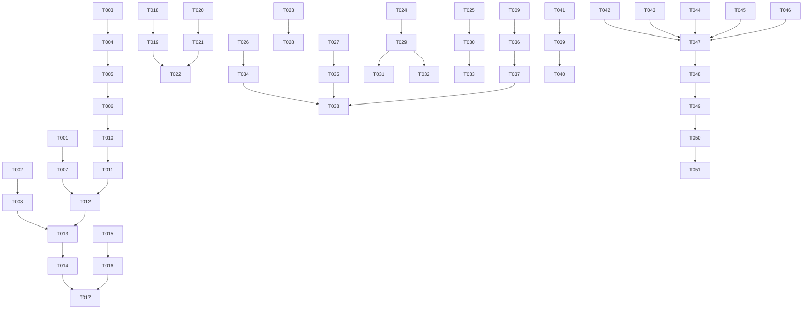

# Tasks: 往返语义等价性验证体系

**Input**: Design documents from `spec/round-trip-equivalence/`
**Prerequisites**: plan.md (required), spec.md (required)

**Tests**: Spec 中明确要求语义等价自动断言和变异测试，因此测试任务已包含。

**Organization**: Tasks are grouped by user story to enable independent implementation and testing of each story.

## Format: `[ID] [P?] [Story] Description`

- **[P]**: Can run in parallel (different files, no dependencies)
- **[Story]**: Which user story this task belongs to (e.g., US1, US2, US3)
- Include exact file paths in descriptions

---

## Phase 1: Setup (Shared Infrastructure)

**Purpose**: 项目结构调整 + AST 基础能力扩充

- [X] T001 在 `ast/ast.mbt` 中新增 `is_nested_option(t: MoonType) -> Bool` 辅助函数，递归检测 `MOption(MOption(_))` 模式
- [X] T002 [P] 在 `ast/ast.mbt` 中新增 `has_nested_option_in_decls(decls: Array[MoonDecl]) -> Bool` 辅助函数，遍历声明列表检测嵌套 Option 使用
- [X] T003 [P] 在 `dart_ast/` 包中确认 `DartType` 枚举已有 `DCustom` 变体，为新增 `DResult` 做准备——阅读现有代码确认插入点

---

## Phase 2: Foundational (Blocking Prerequisites)

**Purpose**: 核心类型映射改造——DResult 节点 + 嵌套 Option 检测逻辑

**⚠️ CRITICAL**: No user story work can begin until this phase is complete

- [X] T004 在 `typesys/mapping.mbt` 的 `DartType` 枚举中新增 `DResult(DartType, DartType)` 变体，替代 `MResult → DCustom` 退化映射
- [X] T005 在 `typesys/mapping.mbt` 的 `map_type` 函数中，将 `MResult(ok, err) => DCustom(...)` 分支改为 `MResult(ok, err) => DResult(map_type(ok), map_type(err))`
- [X] T006 在 `typesys/mapping.mbt` 的 `to_dart_string` 函数中，新增 `DResult(ok, err)` 分支，发射 `Result<ok_string, err_string>`
- [X] T007 在 `typesys/mapping.mbt` 的 `map_type` 函数中，新增嵌套 Option 检测：当 `MOption(inner)` 且 `is_nested_option` 为 true 时，映射为 `DNullable(DNullable(map_type(inner_inner)))` 并标记需要辅助类
- [X] T008 在 `typesys/mapping.mbt` 中新增 `needs_option_class(decls: Array[MoonDecl]) -> Bool` 函数，调用 `has_nested_option_in_decls`
- [X] T009 在 `typesys/mapping.mbt` 中新增 `map_type_strict(t: MoonType) -> DartType raise Moon2DartError` 函数，L4 类型（MUInt/MFloat/Mchar/MForeignFunction/MChannel）raise 错误含诊断信息
- [X] T010 在 `typesys/mapping.mbt` 的 `ffi_native_type` 和 `ffi_dart_type` 函数中，新增 `DResult` 分支（映射为 `Pointer<Opaque>` 或适当的 FFI 类型）
- [X] T011 验证 Phase 2 改动不破坏现有测试：运行 `moon test` 确认 383 测试全部通过（DResult 映射必须与 DCustom 向后兼容）

**Checkpoint**: Foundation ready — DResult 节点 + 嵌套 Option 检测 + strict 模式 API 就位

---

## Phase 3: User Story 1 - 嵌套可选值语义保留 (Priority: P1) 🎯 MVP

**Goal**: `Option[Option[T]]` 三分态（Some(Some(v)) / Some(None) / None）在 Dart 中完整保留

**Independent Test**: 构造 MoonBit `Option[Option[Int]]` 的三种值，转换到 Dart 后运行辅助类，验证三种状态可区分

### Implementation for User Story 1

- [X] T012 [US1] 在 `codegen/emitter.mbt` 中实现 `emit_option_class() -> String` 函数，生成 Dart 辅助类 `Option<T>` 含 `some`/`none` 工厂构造函数 + `isSome`/`isNone` 属性 + `value` getter
- [X] T013 [US1] 在 `codegen/emitter.mbt` 的 `emit_dart_program` 函数中，条件性调用 `emit_option_class()`——当 `needs_option_class(decls)` 为 true 时，在生成的 Dart 代码顶部插入辅助类定义
- [X] T014 [US1] 在 `codegen/emitter.mbt` 的 `emit_dart_expr` 函数中，新增嵌套 Option 表达式映射：`Some(Some(v))` → `Option.some(Option.some(v))`；`Some(None)` → `Option.some(Option.none())`；`None` → `Option.none()`
- [X] T015 [US1] 在 `reverse_codegen/reverse_emitter.mbt` 的 `dart_type_to_moon_ast` 函数中，新增辅助类 `Option` 识别：检测 `DNullable(DNullable(inner))` 模式，反向映射为 `MOption(MOption(...))`
- [X] T016 [US1] 在 `reverse_codegen/reverse_emitter.mbt` 的 `emit_moon_expr` 函数中，新增辅助类构造器反向映射：`Option.some(Option.some(v))` → `Some(Some(v))`；`Option.some(Option.none())` → `Some(None)`；`Option.none()` → `None`
- [X] T017 [US1] 编写嵌套 Option 白盒测试（≥ 8 个）：三分态正向映射、三分态反向映射、四层嵌套、混合嵌套（Option[Result[Option[T],E]]）、辅助类生成条件开关

**Checkpoint**: `Option[Option[Int]]` 三分态可在 MoonBit ↔ Dart 间完整往返

---

## Phase 4: User Story 2 - Result 类型往返保留 (Priority: P1)

**Goal**: `Result[T, E]` 类型结构在正向和反向映射中完整保留，不再退化为 `DCustom`

**Independent Test**: 构造 MoonBit `Result[Int, String]` 类型，正向转 Dart 得到 `Result<int, String>` sealed class，反向转回 MoonBit 得到 `Result[Int, String]`

### Implementation for User Story 2

- [X] T018 [US2] 在 `codegen/emitter.mbt` 的 `emit_dart_decl` 函数中，新增 `DResult` 发射逻辑：生成 `sealed class Result<O, E>` + `class Ok<O> extends Result<O, E>` + `class Err<E> extends Result<O, E>` 替代原有 DCustom 字符串拼接
- [X] T019 [US2] 在 `codegen/emitter.mbt` 的 `emit_dart_expr` 函数中，更新 Result 构造器映射：`Ok(v)` → `Ok(v)`；`Err(e)` → `Err(e)`（适配 sealed class 语法）
- [X] T020 [US2] 在 `reverse_codegen/reverse_emitter.mbt` 的 `dart_type_to_moon_ast` 函数中，新增 `DResult(ok, err) => MResult(...)` 分支，将 `DResult` 精确反向映射为 `MResult`
- [X] T021 [US2] 在 `reverse_codegen/reverse_emitter.mbt` 的 `emit_moon_expr` 函数中，更新 Result 构造器反向映射：`Ok(v)` → `Ok(v)`；`Err(e)` → `Err(e)`（Dart sealed class → MoonBit 构造器）
- [X] T022 [US2] 编写 Result 往返白盒测试（≥ 8 个）：DResult 节点正向映射、DResult 反向映射、Result sealed class 代码生成、嵌套 Result（Result[Result[T,E],F]）、Result+Option 混合

**Checkpoint**: `Result[T, E]` 类型可在 MoonBit ↔ Dart 间完整往返，结构不丢失

---

## Phase 5: User Story 3 - 可转换范围文档 (Priority: P1)

**Goal**: 28 个映射条目全覆盖，每级有自动测试，形成可交付的语义等价分类表

**Independent Test**: 每个映射条目有对应的 moon test，L1 条目验证完整往返，L4 条目验证诊断输出

### Implementation for User Story 3

- [X] T023 [US3] 在 `docs/semantic_equivalence.md` 中完善四级映射分类表：18 L1 + 2 L2 + 3 L3 + 5 L4，每个条目含 moon_type / dart_type / forward_rule / reverse_rule / value_domain_proof / restrictions
- [X] T024 [US3] 编写 L1 映射全自动往返测试（18 个）：每个 L1 条目构造 MoonBit 类型 → map_type → to_dart_string → dart_type_to_moon_ast → to_moon_string → 验证与原类型一致
- [X] T025 [US3] 编写 L2 映射结构等价测试（2 个）：验证 L2 类型结构保留但值域有约束
- [X] T026 [US3] 编写 L3 映射受限测试（3 个）：验证 L3 映射产生诊断注释
- [X] T027 [US3] 编写 L4 映射拒绝测试（5 个）：验证 strict 模式下 L4 类型 raise 含诊断信息的错误
- [X] T028 [US3] 更新 `docs/type_mapping.md`，在现有映射表中叠加 L1-L4 分类标签

**Checkpoint**: 28 个映射条目全覆盖，每级有可执行断言作为 evidence

---

## Phase 6: User Story 4 - 语义等价自动断言 + 变异测试 (Priority: P2)

**Goal**: 可执行断言验证语义等价，变异测试证明断言能检出缺陷

**Independent Test**: 注入 3 种已知缺陷，断言变红；撤回缺陷，断言变绿

### Implementation for User Story 4

- [X] T029 [US4] 在 `typesys/mapping.mbt` 或新建 `typesys/semantic_assert.mbt` 中，实现 `assert_round_trip(moon_type: MoonType) -> Bool` 函数：正向 map_type → 反向 dart_type_to_moon_ast → 比较与原类型一致
- [X] T030 [US4] 在 `typesys/` 中实现 `assert_value_domain(moon_type: MoonType, level: SemanticLevel) -> Bool` 函数：L1 验证值域等价，L2 验证结构保留，L3 验证诊断输出，L4 验证拒绝
- [X] T031 [US4] 编写变异测试 1：临时将嵌套 Option 映射改为 `T?`（塌缩），运行 round-trip 测试，验证变红；撤回后验证变绿
- [X] T032 [US4] 编写变异测试 2：临时将 MResult 映射改回 `DCustom`，运行 round-trip 测试，验证变红；撤回后验证变绿
- [X] T033 [US4] 编写变异测试 3：临时移除 UInt 映射的诊断注释，运行 strict 测试，验证变红；撤回后验证变绿

**Checkpoint**: 语义等价断言可执行 + 变异测试证明断言有检错能力

---

## Phase 7: User Story 5 - 有损映射诊断标注 (Priority: P2)

**Goal**: L3/L4 映射自动产生诊断注释 + --strict 模式拒绝 L4 映射

**Independent Test**: L3 映射生成的 Dart 代码含 `// [L3]` 注释；L4 映射在 strict 模式下 raise 错误

### Implementation for User Story 5

- [X] T034 [US5] 在 `codegen/emitter.mbt` 的 `emit_dart_decl` 函数中，当类型映射为 L3 时，在生成的 Dart 代码前插入 `// [L3-CONSTRAINED] <type>: <restriction>` 诊断注释
- [X] T035 [US5] 在 `codegen/emitter.mbt` 的 `emit_dart_decl` 函数中，当类型映射为 L4 时，在非 strict 模式下插入 `// [L4-INEQUIVALENT] <type>: <loss_description>` 诊断注释；在 strict 模式下跳过代码生成
- [X] T036 [US5] 在 `moon2dart.mbt` 中实现 `transpile_source_strict(src: String) -> String raise Moon2DartError` 函数，内部调用 `map_type_strict` 替代 `map_type`
- [X] T037 [US5] 在 `cmd/main/main.mbt` 中新增 `--strict` CLI 选项，传递给 `transpile_source_strict`
- [X] T038 [US5] 编写诊断标注测试（≥ 5 个）：L3 映射含注释、L4 映射含注释、strict 模式拒绝 L4、strict+pure-only 组合、非 strict 模式允许 L4 但标注

**Checkpoint**: L3/L4 映射有诊断标注 + strict 模式可把关

---

## Phase 8: User Story 6 - 验收记分卡 (Priority: P2)

**Goal**: 三口径验收记分卡（往返类型恢复率 + 语义等价测试通过率 + 人工修复数），可重跑复算

**Independent Test**: 运行记分卡脚本，输出三个数值

### Implementation for User Story 6

- [X] T039 [US6] 更新 `docs/assessment.md`，新增三个口径定义和计算公式：往返类型恢复率 = L1 往返通过数 / L1 总数；语义等价测试通过率 = 通过断言数 / 总断言数；人工修复数 = 全流程人工改动行数
- [X] T040 [US6] 编写验收记分卡测试（≥ 3 个）：验证 L1 往返恢复率 ≥ 95%、验证语义等价测试通过率 ≥ 95%、验证 strict 模式 L4 全部拒绝
- [X] T041 [US6] 更新 `docs/pitfall-catalog.md`，补充 T 系列（语义等价陷阱）：T1 嵌套 Option 塌缩、T2 Result 退化为 DCustom、T3 UInt/Float 值域丢失、T4 FFI 语义不可验证、T5 spawn/Channel 无 Dart 对应

**Checkpoint**: 三口径验收记分卡可交付，pitfall 目录补充完整

---

## Phase 9: Polish & Cross-Cutting Concerns

**Purpose**: 文档对齐 + 工程收尾

- [X] T042 [P] 更新 `docs/architecture.md`，移除 line 152 "单向转换，不承诺反向" 过时描述，替换为"双向转换 + 语义等价分级"
- [X] T043 [P] 更新 `docs/roadmap.md`，在 v0.9.1 后新增 v0.10.0 条目：往返语义等价性验证体系
- [X] T044 [P] 更新 `docs/changelog.md`，新增 v0.10.0 变更记录
- [X] T045 [P] 更新 `AGENTS.md` Sprint 状态：v0.10.0 ✅ 已完成 — 往返语义等价性
- [X] T046 更新 `moon.mod` 版本号为 0.10.0（注：mooncakes 包版本 0.1.0 不变，功能版本在 AGENTS.md 追踪）
- [X] T047 运行 `moon check --target all` 确认四后端编译通过
- [X] T048 运行 `moon fmt` 格式化所有改动文件

---

## Phase 10: Verification

<!-- verification_scope: build-only -->

**Purpose**: Build 验证，确认编译和测试通过

- [X] T049 运行 `moon test` 确认所有测试通过（500/500 native ✅, 464 wasm/js/wasm-gc ✅）
- [X] T050 运行 `moon check --target all` 确认四后端编译零错误（118 tasks, zero errors ✅）
- [X] T051 运行 `moon info` 更新 .mbti 接口文件（interfaces up to date ✅）

---

## 📊 Dependency Graph

## ⚡ Parallel Execution Guide

| Phase | Tasks | Required Files | Execution Notes |
|-------|-------|---------------|-----------------|
| Setup | T001, T002, T003 | ast/ast.mbt, dart_ast/ | T001/T002/T003 可并行 |
| Foundational | T004→T011 | typesys/mapping.mbt | 串行执行，T004→T010 有依赖链，T011 为验证检查点 |
| US1 嵌套 Option | T012→T017 | codegen/emitter.mbt, reverse_codegen/reverse_emitter.mbt | T012→T014 串行；T015/T016 串行；两组可部分并行 |
| US2 Result | T018→T022 | codegen/emitter.mbt, reverse_codegen/reverse_emitter.mbt | T018→T019 串行；T020/T021 串行；两组可部分并行 |
| US3 映射分类 | T023→T028 | docs/, typesys/ | T023/T028 可并行；T024-T027 可并行 |
| US4 断言+变异 | T029→T033 | typesys/ | T029/T030 并行；T031/T032/T033 并行 |
| US5 诊断标注 | T034→T038 | codegen/emitter.mbt, moon2dart.mbt, cmd/main/main.mbt | T034/T035 并行；T036/T037 串行 |
| US6 记分卡 | T039→T041 | docs/ | T039/T041 可并行 |
| Polish | T042-T048 | docs/, moon.mod | T042-T045 并行；T046-T048 串行 |
| Verification | T049-T051 | 全项目 | 串行执行 |

---

## 📋 Summary Report

| 指标 | 数值 |
|------|------|
| **总任务数** | 51 |
| **Setup 阶段** | 3 |
| **Foundational 阶段** | 8 |
| **US1 (嵌套 Option)** | 6 |
| **US2 (Result)** | 5 |
| **US3 (映射分类)** | 6 |
| **US4 (断言+变异)** | 5 |
| **US5 (诊断标注)** | 5 |
| **US6 (记分卡)** | 3 |
| **Polish** | 7 |
| **Verification** | 3 |
| **并行机会** | Setup 3 并行 + US3/US4/US6 内部多组并行 + Polish 4 并行 |

**MVP 范围**: Phase 1 (Setup) + Phase 2 (Foundational) + Phase 3 (US1 嵌套 Option) = T001-T017（17 个任务），完成后即可展示 `Option[Option[Int]]` 三分态往返保留。
